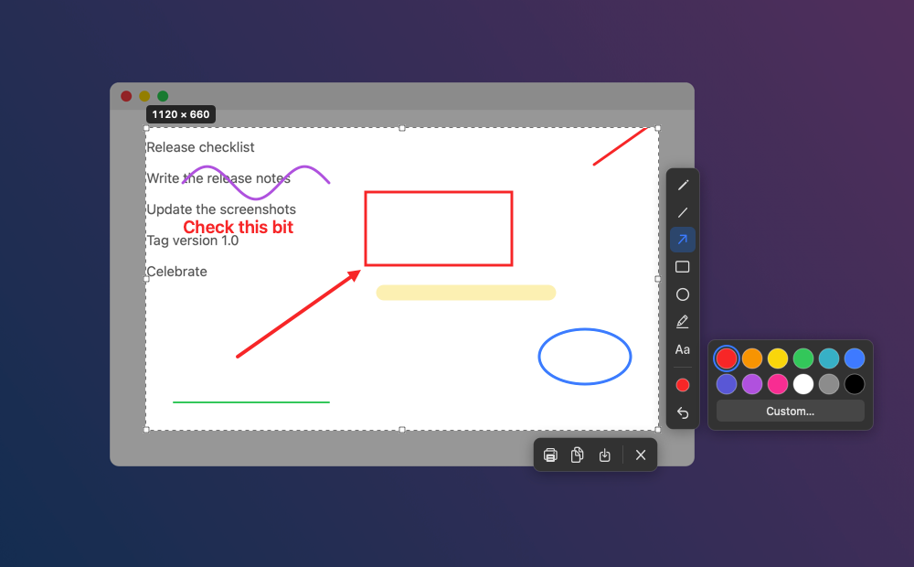

# Glimpse

A fast, native screenshot tool for macOS on Apple Silicon. Press a shortcut, drag over part of the
screen, mark it up, and copy or save it.

It follows the workflow of [Lightshot](https://app.prntscr.com/), whose Mac app is Intel-only and
runs under Rosetta. Glimpse has no account, upload, sharing or online gallery: **screenshots never
leave your Mac.**



## Features

- Global shortcut (**⇧⌘9** by default) and a menu bar icon
- Freeze the screen, drag to select, then move or resize the selection
- Pencil, line, arrow, rectangle, ellipse, highlighter and text, in 12 colours or any custom colour
- Copy to the clipboard, save as PNG or JPEG, or print
- The last 5 screenshots stay in the menu bar menu, ready to copy again
- Full Retina resolution (or 1× if you prefer), with multiple displays supported
- Written in Swift with AppKit and ScreenCaptureKit, with no dependencies

## Requirements

- A Mac with Apple Silicon, running macOS 14 Sonoma or later
- Xcode or the Xcode Command Line Tools (`xcode-select --install`), to build it

## Install

There's no prebuilt download yet, so build it from source:

```bash
git clone https://github.com/nathanm95/glimpse.git
cd glimpse
scripts/make-signing-identity.sh   # optional, recommended: see "Screen Recording permission"
scripts/build.sh --install         # builds Glimpse.app and copies it to /Applications
open /Applications/Glimpse.app
```

Glimpse lives in the menu bar and has no Dock icon. On first launch it opens its Settings window.

### Screen Recording permission

macOS asks for Screen Recording permission the first time you take a screenshot. Turn on Glimpse in
**System Settings → Privacy & Security → Screen & System Audio Recording**, then reopen it.

macOS ties that permission to the app's code signature. A build signed *ad hoc* (the fallback) gets
a new signature every time, so after each rebuild you'd have to grant the permission again. To avoid
that, run `scripts/make-signing-identity.sh` once. It creates a self-signed certificate called
"Glimpse Local Signing" in your login keychain. The certificate is only used to sign your own
builds, and `scripts/build.sh` picks it up automatically.

If the permission ever gets stuck, reset it and grant it again:

```bash
tccutil reset ScreenCapture com.nathanm95.glimpse
```

## Using it

Press the shortcut, or choose **Take Screenshot** from the menu bar icon. The screen freezes and
dims; drag to select an area.

| Action | How |
|---|---|
| Move or resize the selection | Drag inside it, or drag an edge or corner. Arrow keys nudge it (hold ⇧ for 10 points) |
| Square selection or shape, 45° lines | Hold ⇧ while dragging |
| Select the whole screen | ⌘A |
| Tools | Pencil (P), Line (L), Arrow (A), Rectangle (R), Ellipse (E), Marker (M), Text (T). Click a tool again to go back to moving the selection |
| Line width and text size | Scroll wheel, or `[` and `]` |
| Colour | The colour button: 12 swatches, or Custom… for the system colour picker |
| Undo | ⌘Z or the undo button |
| Copy and close | ⌘C |
| Save | ⌘S. PNG or JPEG, named like `Screenshot at Oct 20 14-05-33.png`. The dialog opens in Downloads |
| Print | ⌘P |
| Close | Esc |

**Text:** with the Text tool, click to place a label, type, then press Return or click elsewhere.
Esc discards a label you're still typing.

**Multiple displays:** each display gets its own overlay. Starting a selection on one clears the
others.

### Recent screenshots

Click the menu bar icon to see the last 5 screenshots you copied, saved or printed. Click one to
put it back on the clipboard; the icon briefly turns into a tick. **Clear Recent** deletes them.

They're stored as PNGs in `~/Library/Application Support/Glimpse/History`. Turn off "Keep the last
5 screenshots" in Settings to stop keeping them; that also deletes the ones already there.

## Settings

- **Screenshot shortcut:** click it, then press the new combination (Esc cancels)
- **Keep the last 5 screenshots in the menu bar menu:** on by default
- **Save Retina screenshots at standard resolution (1×):** off by default, so Retina captures are
  full resolution at 144 dpi, like macOS's own screenshots
- **Open Glimpse at login**

## Privacy

Glimpse makes no network requests. Screenshots go only where you send them: the clipboard, a file
you save, or a printer. The recent-screenshots list is kept locally as described above.

## Development

```bash
scripts/build.sh          # build build/Glimpse.app (arm64)
scripts/make-icon.sh      # redraw Resources/AppIcon.icns from scripts/make-icon.swift
```

These offline checks need no Screen Recording permission:

```bash
BIN=$(swift build -c release --arch arm64 --show-bin-path)/Glimpse
$BIN --render-test /tmp/render.png    # an exported image with every annotation type
$BIN --ui-snapshot /tmp/overlay.png   # the overlay UI on a fake desktop
mkdir -p /tmp/glimpse-history && GLIMPSE_HISTORY_DIR=/tmp/glimpse-history \
  $BIN --history-test /tmp/thumb.png  # keeps the newest 5 and copies back (private pasteboard)
```

| File | Role |
|---|---|
| `HotKey.swift` | Global shortcut through Carbon `RegisterEventHotKey`, which needs no Accessibility permission |
| `ScreenGrabber.swift` | Captures each display with ScreenCaptureKit at full pixel resolution |
| `CaptureSession.swift` | One capture: an overlay per screen, the shared tool, colour and width, and copy, save and print |
| `OverlayView.swift` | Frozen image, selection, mouse and keyboard handling, text entry, toolbar placement |
| `Annotation.swift` | Drawing tools; the same code draws the live overlay and the exported image |
| `Renderer.swift` | Crops the selection from the frozen image and draws the annotations onto it |
| `Toolbar.swift` | Tool buttons, toolbars and the colour palette |
| `History.swift` | Recent screenshots on disk, menu thumbnails, and copying them back to the clipboard |
| `SettingsWindow.swift` | Settings window and shortcut recorder |

## License

[MIT](LICENSE). Glimpse is an independent project and isn't affiliated with Lightshot or Skillbrains.
